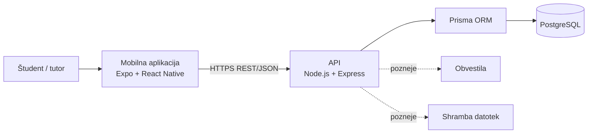
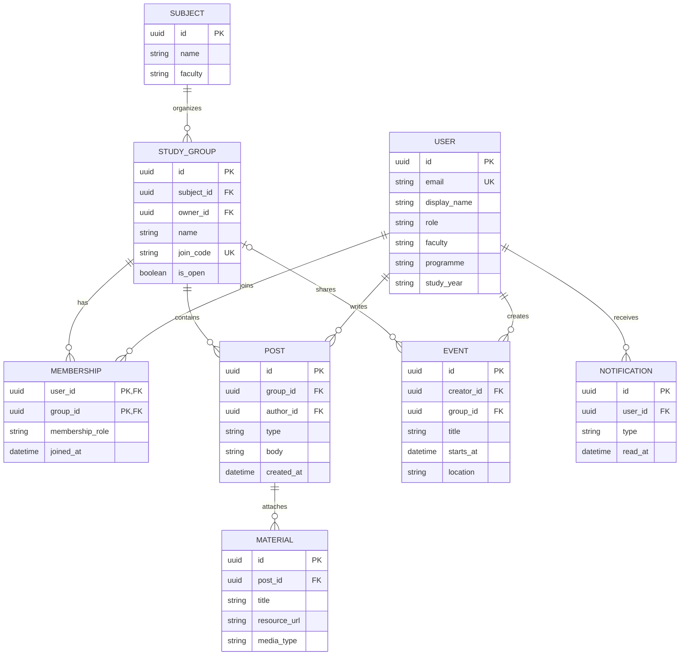

# Arhitektura in podatkovni model

## Načrtovane tehnologije

| Plast | Tehnologija | Vloga |
|---|---|---|
| Mobilni odjemalec | Expo, React Native, TypeScript | Zasloni, navigacija in uporabniški tokovi |
| API | Node.js, Express, TypeScript | Avtentikacija, poslovna pravila in REST vmesnik |
| Baza | PostgreSQL | Trajna hramba uporabnikov, skupin in vsebine |
| Dostop do podatkov | Prisma ORM | Modeliranje, migracije in poizvedbe |
| Sodelovanje in CI | GitHub, GitHub Actions | Izvorna koda, Issues, pregled sprememb in avtomatska preverjanja |

To je začetni načrt na podlagi projektnega opisa. V repozitoriju še ni implementiranih odjemalca, API-ja ali baze.

## Začetna arhitektura

Odjemalec kliče API prek HTTPS. API uveljavlja pravice dostopa, validira vnose in prek Prisma dostopa do PostgreSQL. Datoteke in push obvestila so zunanje integracije za poznejšo odločitev.

## Začetni domenski model

To je logični začetni model za MVP. Pred migracijami je treba še doreči pravila brisanja, zasebnost dogodkov, vloge v skupini, shranjevanje datotek in način prijave. Osebni dogodek ima `group_id = null`; skupni dogodek je povezan s skupino.
