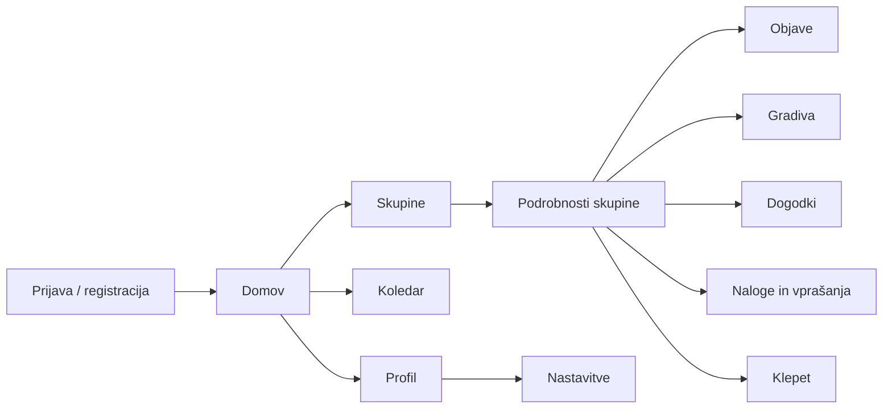

# Mockupi in navigacija

Na voljo sta dve interaktivni vizualni različici z enakimi zasloni, uporabniškimi tokovi in interakcijami:

- [Prvotni prototip](../prototip/index.html) uporablja vijolično paleto in mehkejše, bolj zaobljene kartice.
- [Alternativni prototip](../prototip/alternativa.html) uporablja zeleno in toplo nevtralno paleto, bolj zadržane kartice ter drugačen slog gumbov in oznak.

Oba prototipa prikazujeta mobilni okvir, prilagodljiv svetli in temni videz ter spodnjo navigacijo. Zasloni so namenjeni preverjanju toka in vsebine, ne predstavljajo končnega vizualnega sistema ali delujočega zaledja.

## Zasloni

| Zaslon | Namen | Glavna dejanja |
|---|---|---|
| Prijava in registracija | Vstop študenta ali tutorja | Prijava, izbira vloge, vnos profila |
| Domov | Hiter pregled obveznosti in bližnjic | Odpri skupino, koledar, časovnik ali obvestila |
| Skupine | Pregled mojih in odkritih skupin | Iskanje, pridružitev, ustvarjanje skupine |
| Prostor skupine | Vsebina izbranega predmeta | Objave, gradiva, dogodki, opravila, vprašanja, klepet |
| Koledar | Mesečni/dnevni pogled rokov in srečanj | Dodaj osebni dogodek ali skupni termin |
| Profil in nastavitve | Osebni podatki in nastavitve | Uredi profil, jezik, obvestila, shranjena gradiva |
| Tutor in učna soba | Razširitveni tok za tutorje | Uredi tutorski profil, odpri sobo, komuniciraj s člani |

## Navigacijski tok

## Navigacijska načela

Primarni razdelki so stalno dostopni iz spodnje navigacije. Vsebina skupine je organizirana v zavihke. Ustvarjanje vsebine se sproži iz konteksta, kjer bo prikazana. V prototipu so prikazani tudi dodatni tokovi, kot so Pomodoro, zasebna sporočila in tutorski portal.
