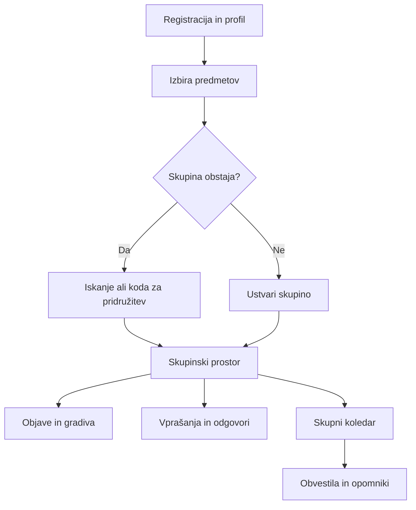

# Projektni načrt

## Namen

StudyBuddy je mobilna aplikacija za organizacijo skupinskega učenja. Namenjena je študentom, ki želijo najti sošolce pri posameznem predmetu, sodelovati pri študijskih vsebinah in imeti pregled nad roki. Problem, ki ga naslavlja, je razpršenost informacij med e-pošto, sporočilnimi aplikacijami in spletnimi učilnicami.

## Uporabniki in vrednost

Glavna ciljna skupina so študenti. Študent ustvari profil s fakulteto, smerjo, letnikom in predmeti, poišče skupino ali jo ustvari ter se pridruži z odprtim dostopom oziroma povabilom. Član skupine spremlja objave, gradiva, vprašanja in dogodke. Tutor je dodatna uporabniška vloga, ki lahko predstavi predmete in vodi učno sobo; ta del je v prototipu prikazan kot razširitev.

## Glavne funkcionalnosti prvega obsega

1. **Račun in profil:** registracija, prijava ter urejanje osnovnih podatkov in predmetov.
2. **Študijske skupine:** ustvarjanje skupine po predmetu, iskanje, pregled podrobnosti in pridružitev prek kode ali povabila.
3. **Skupinska vsebina:** objave, vprašanja, odgovori, gradiva in povezave, vezane na skupino oziroma predmet.
4. **Koledar:** skupni roki in termini učenja z datumom, uro, opisom, lokacijo in opomnikom.
5. **Obvestila:** opozorila o prihajajočih dogodkih ter novih objavah in gradivih.

Pomodoro, osebni zapiski, shranjena gradiva, ankete, seznam opravil, iskanje partnerja, zasebna sporočila in tutorji so kandidati za naslednje iteracije. Razvrstitev se lahko spremeni po povratnih informacijah in oceni časa.

## Ključni uporabniški scenariji

UML diagram glavnih primerov uporabe je na voljo v urejevalni datoteki [diagram-primerov-uporabe.drawio](diagram-primerov-uporabe.drawio).

- **Prvi obisk:** študent se registrira, izpolni profil in izbere predmete.
- **Vključitev v skupino:** študent poišče skupino po predmetu, odpre njen opis in se pridruži ali uporabi kodo.
- **Skupno delo:** član deli gradivo ali vprašanje; drugi člani ga najdejo v zavihku skupine.
- **Dogovor o učenju:** član predlaga skupni termin z uro in lokacijo; skupina ga vidi v koledarju.
- **Spremljanje obveznosti:** študent odpre koledar ali domači zaslon in preveri prihajajoče roke.

## Omejitve in predpostavke

Predviden je mobilni vmesnik. Prototip uporablja lokalne vzorčne podatke in simulirane interakcije; prijava, shranjevanje, klepet in obvestila v njem niso povezani z zalednim sistemom. Produkcijska avtentikacija, pravice dostopa in hramba datotek bodo določene ob implementaciji.
